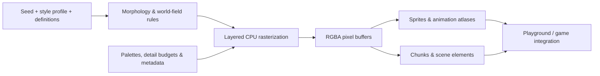

<div align="center">

**Languages:** **English** | [Español](README.es.md) | [Português (Brasil)](README.pt-BR.md)

# PPAE Engine

### Procedural Pixel Art Engine

**Pixel art is more powerful when it's a system, not just a collection of sprites.**

A deterministic, modular pixel-art generation toolkit for 2D games.  
Create characters, creatures, environments, animation frames, and visual effects from TypeScript — with reproducible results and inspectable source code.

[](https://github.com/Mairon31/ppae-engine/tree/master)
[](package.json)
[](tsconfig.json)
[](https://github.com/Mairon31/ppae-engine/actions/workflows/ppae-2-ci.yml)
[](LICENSE)

**[Explore the Playground](https://mairon31.github.io/ppae-engine/)** · **[View source on master](https://github.com/Mairon31/ppae-engine/tree/master)** · **[Contribute on GitHub](https://github.com/Mairon31/ppae-engine/issues)**

</div>

---

## Pixel art, generated with purpose

**PPAE** is an open-source procedural graphics toolkit built in **strict TypeScript**. Instead of treating every frame, variation, or environmental prop as an isolated asset, PPAE models the rules behind them: anatomy, morphology, palettes, direction, materials, animation states, and seeded variation.

The same generation pipeline can produce a tree with different life stages, a character viewed from eight directions, an animated shoreline, or a creature atlas with structured metadata. The goal is not to replace artists: it is to give artists, game developers, and creative programmers a **programmable foundation for coherent 2D visual worlds**.

PPAE began as a technology project for [PixelProject](https://github.com/Mairon31/pixelproject), but it is being developed as a **standalone, reusable engine**.

> **What PPAE is:** a procedural pixel-art generation library with a visual Playground and game-integration utilities.  
> **What it is not:** a complete game engine with built-in gameplay, physics, networking, or an editor comparable to Godot or Unity.


## AI-assisted development disclosure

> **Transparency notice:** PPAE Engine is developed with assistance from artificial intelligence tools for programming, tests, documentation and technical exploration. AI assistance does not guarantee error-free or production-ready results. Maintainers are responsible for accepting changes, and users should independently review and validate outputs.

## See the engine in action

<div align="center">

### [Explore the product landing →](https://mairon31.github.io/ppae-engine/)

**[Launch the 32-lab Playground →](https://mairon31.github.io/ppae-engine/#world)**

**32 interactive laboratories. Hundreds of seeded variants. Real engine-generated assets — no prerecorded mockups.**

Explore a full player appearance editor with seeded randomization, 28 character actions, NPC diversity, creature morph variations, boss states, plant lifecycles, seamless materials, 256 autotile inputs, liquids, world generation, weather, VFX, native resolution profiles, and biome color palettes.

</div>

The Playground lets you change **seed, resolution, direction, action, lifecycle stage, creature age and health, zoom, playback speed, time of day, and weather**, plus editable avatar anatomy, hairstyle, clothing, skin/hair/armor colors, accessories, and status effects. Export **native sprite PNG, viewport screenshots, PNG spritesheets, structured JSON atlases, or per-system metadata**. Browse every section with search and pagination.

**Public developer documentation is planned for GitHub Pages.** Until it launches, use the Playground and the examples in this README.

## What can PPAE generate?

| System | Implemented capabilities |
| :--- | :--- |
| **Characters & NPCs** | Anatomical character generation, 16-joint rigs, eight directions, customizable appearances and equipment, eight NPC profession archetypes, and 28 character actions. |
| **Creatures & bosses** | 16 species across 10 anatomical families, 12 creature actions, directional animation, age/health variations, and two multisegment boss archetypes. |
| **Trees & vegetation** | 12 botanical families with structural archetypes and lifecycle stages, plus 17 secondary-flora types and seeded ecological variation. |
| **Terrain & water** | Deterministic world fields, chunk rendering, 47-state autotiling, terrain transitions, roads, coasts, animated liquids, and biome-aware materials. |
| **Geology & environments** | 17 geological resource/formations, structures, roofs, interior layouts, caves, agricultural crops, and world props. |
| **Animation & export** | Eight-direction spritesheet compilation, per-frame metadata, anchors, hitboxes, animation events, and padded texture atlases. |
| **VFX & atmosphere** | 16 particle-emitter presets with four native pixel geometries, wind, branched lightning, layered fog, time-of-day solar shadows, and quantized lightmaps. |
| **UI & equipment** | Procedurally generated equipment icons, inventory/HUD primitives, and nine-slice interface panels. |
| **Art quality diagnostics** | Quantitative silhouette and palette checks, directional lighting/noise heuristics, tile-seam audits and a versioned 10-specimen reference registry with RGBA fingerprints. |
| **Production scene and visual inspector** | Lazy production-engine scene composition, Y-sorted world objects, solar lighting, roof cutaway, live telemetry and five native-resolution quality comparisons; 32 working Playground labs. |

These capabilities are available from the default `master` branch. New work is merged when ready; visual polish, performance, and feature coverage continue to evolve during alpha.

## Designed for developers — including vibe coders

<table>
<tr>
<td width="50%" valign="top">
<h3>For indie game creators</h3>
<p>Build variations without manually redrawing every asset. Start from structured definitions, regenerate with a seed, and keep art direction consistent across world content.</p>
</td>
<td width="50%" valign="top">
<h3>For AI-assisted builders</h3>
<p>Work with a typed, inspectable TypeScript API rather than an opaque image service. Let coding agents prototype around deterministic generators while keeping the implementation reviewable.</p>
</td>
</tr>
<tr>
<td width="50%" valign="top">
<h3>For technical artists</h3>
<p>Explore anatomical rules, botanical silhouettes, palette constraints, layer composition, and procedural animation. Contribute better visual systems, not just more assets.</p>
</td>
<td width="50%" valign="top">
<h3>For experienced engineers</h3>
<p>Help improve raster quality, visual regression testing, caching, profiling, sprite atlases, browser performance, and integration with game frameworks.</p>
</td>
</tr>
</table>

### Core engineering principles

- **Seeded and reproducible.** Identical inputs follow deterministic generation paths; cross-runtime bitwise parity is not yet certified for every system.
- **Code-first, engine-independent generation.** Produce pixel buffers and metadata in TypeScript without requiring an image-generation API or GPU-based sprite generation.
- **Native pixel-art detail.** Resolution profiles adapt generation rules and detail budgets rather than merely upscaling a low-resolution bitmap.
- **Layered architecture.** Morphology, palettes, rasterization, animation, world generation, and integration are separate systems.
- **Inspectable outputs.** Explicit RGBA buffers, dimensions, pivots, anchors, and atlas metadata make generated assets usable beyond the Playground.
- **Practical constraints.** CPU-generation benchmarks, caches, particle object pooling, and automated tests are part of the codebase. End-to-end game FPS and GPU performance require separate measurement.

## Five native visual resolutions

| Style profile | Module size | Intended use |
| :--- | :---: | :--- |
| `micro-4x4` | 4 × 4 | Compact assets and quick previews |
| `micro-6x6` | 6 × 6 | Small, expressive sprites |
| `classic-8x8` | 8 × 8 | Balanced traditional pixel art |
| `standard-16x16` | 16 × 16 | More detailed characters and environments |
| `detailed-32x32` | 32 × 32 | Higher-detail procedural rendering |

Hybrid and adaptive profiles are also implemented. Here, **module size** describes the generation granularity — not a universal fixed sprite canvas size.

## Quick start

**Requirements:** Node.js `^20.19.0` or `>=22.12.0` and npm.

Use the default **`master`** branch for the current public version. Other branches may contain experimental, unmerged work.

```bash
git clone --branch master https://github.com/Mairon31/ppae-engine.git
cd ppae-engine
npm ci
npm run dev
```

Open the local Vite URL shown in your terminal (normally `http://localhost:5173/`).

### Validate or build

```bash
npm run typecheck       # Strict TypeScript checks
npm test                # Unit and regression tests
npm run build           # ESM library + declarations + demo
npm run check:package   # Inspect exactly what npm users would download
npm run preview         # Preview the compiled Pages build
```

The full build produces:

- `dist/library/` — bundled ESM library.
- `dist/` — package TypeScript declarations.
- `dist/demo/` — Vite-built standalone Playground for GitHub Pages.

**Distribution note:** the package is named `@pixelproject/ppae` (currently `0.2.0-alpha.1`) in `package.json`; it has not yet been published to npm. Its distributable contains the compiled engine, public TypeScript declarations, README, license and package metadata, excluding the landing page, Playground and tests. CI audits the bundle with `npm pack --dry-run`. Until an official release, build and link or install it locally.

## Use the engine in TypeScript

The examples below use the public package exports. They can be used from a game project once the built package has been installed locally.

### 1. Generate a procedural tree

```ts
import {
  DEFAULT_STYLE_PROFILES,
  NatureGenerator,
} from '@pixelproject/ppae';

const nature = new NatureGenerator();
const profile = DEFAULT_STYLE_PROFILES['classic-8x8'];

const oak = nature.generateTreeStage('oak', 'mature', profile, 2026, {
  envState: 'autumn',
  windShiftTexels: 2,
});

console.log({
  size: [oak.buffer.width, oak.buffer.height],
  pivot: oak.pivotTexel,
  pixels: oak.buffer.data, // Uint8ClampedArray: RGBA pixel data
});
```

The returned pixel buffer is a **real generated asset**, not a URL or a reference to a preset image. The sprite includes a ground pivot for positioning in a game scene.

### 2. Generate a deterministic world chunk

```ts
import {
  ChunkWorldRenderer,
  DEFAULT_STYLE_PROFILES,
  DeterministicWorldField,
} from '@pixelproject/ppae';

const field = new DeterministicWorldField('my-world-seed');
const renderer = new ChunkWorldRenderer(field);

const chunk = renderer.renderChunk(
  0, 0, DEFAULT_STYLE_PROFILES['classic-8x8']
);

console.log(chunk.terrainBuffer.width, chunk.terrainBuffer.height);
console.log(chunk.sortedProps); // Generated world props with placement data
```

### 3. Compile an eight-direction character atlas

```ts
import {
  ALL_DIRECTIONS_8,
  DEFAULT_HERO_APPEARANCE,
  DEFAULT_HERO_EQUIPMENT,
  DEFAULT_STYLE_PROFILES,
  SpritesheetCompiler,
} from '@pixelproject/ppae';

const compiler = new SpritesheetCompiler();
const sheet = compiler.compileCharacterSheet(
  DEFAULT_HERO_APPEARANCE,
  DEFAULT_HERO_EQUIPMENT,
  DEFAULT_STYLE_PROFILES['classic-8x8'],
  ['idle', 'walk', 'attack'],
  ALL_DIRECTIONS_8
);

console.log(sheet.atlasBuffer); // Packed RGBA sprite atlas
console.log(sheet.metadata.frames); // Frame layout, pivots, events, hitboxes
```

In the Playground, supported character and creature selections can also export **PNG atlas images and JSON metadata** directly.

## How it works



The implementation is organized into focused modules:

```text
src/
├── core/          # Contracts, deterministic utilities, coordinates
├── vegetation/    # Trees, botanical morphology, flora, geology
├── terrain/       # World fields, chunks, autotiling, roads, liquids
├── entities/      # Characters, creatures, bosses, anatomy
├── animation/     # Clips, state machines, spritesheet compilation
├── structures/    # Buildings and cave generation
├── interiors/     # Rooms and portals
├── environment/   # Weather and wind
├── lighting/      # Lightmaps and time-of-day effects
├── vfx/           # Visual particle effects (not audio)
├── items/         # Equipment and inventory assets
├── ui/            # HUD and nine-slice primitives
├── runtime/       # Caching, atlases, LOD and culling
├── integration/   # Phaser texture adapter
├── benchmarks/    # CPU asset-generation measurements
└── demo/          # Interactive browser Playground
```

The `PhaserPPAEAdapter` provides a canvas-texture registration path for generated assets. It is an integration utility, not a full Phaser gameplay framework.

## Current status & roadmap

PPAE is under **active alpha development**. The default `master` branch includes the existing engine systems through Phase 12. Further improvements are merged incrementally.

| Area | Status |
| :--- | :--- |
| Procedural generation systems through Phase 12 | Implemented with automated tests |
| Architecture / interiors / caves | Ten structure definitions, three explorable interior layouts, seeded cave formations and separate roof occlusion buffers |
| Browser-based interactive Playground | Available |
| Library, type declarations and demo build | Available |
| Native tree-canopy clipping regression | Fixed and covered by tests |
| Full artistic validation across every seed/profile | Ongoing |
| Broader game-framework integrations and profiling | Opportunities for contributors |

**Follow development:** [Master commits](https://github.com/Mairon31/ppae-engine/commits/master) · [Issues](https://github.com/Mairon31/ppae-engine/issues) · [Open pull requests](https://github.com/Mairon31/ppae-engine/pulls)

We intentionally distinguish **implemented features** from **fully production-validated behavior**. Automated build success is not a substitute for reviewing visual quality, gameplay suitability, or frame times in a real game.

## Contributing

**This project is looking for experienced contributors.** Whether your specialty is procedural graphics, pixel-art direction, rendering, TypeScript architecture, or QA, there is meaningful work to do.

High-impact areas include:

1. **Art quality and procedural silhouettes** — recognizable species, more natural foliage, anatomy, shading, and coherent visual style.
2. **Performance and memory** — sprite/scene caching, high-resolution generation costs, profiling, chunk rendering, and scalability.
3. **Visual regression & QA** — image comparisons, deterministic test fixtures, browser tests, and cross-resolution validation.
4. **Game integrations** — reliable asset export pipelines, Phaser workflows, and interoperable runtime interfaces.
5. **Developer experience** — examples, documentation, debugging tools, typed APIs, and Playground usability.

**How to help:** [Browse issues](https://github.com/Mairon31/ppae-engine/issues), [propose an improvement](https://github.com/Mairon31/ppae-engine/issues/new), or review [open pull requests](https://github.com/Mairon31/ppae-engine/pulls). For substantial changes, open an issue with the problem, expected behavior, and proposed approach before starting a large implementation. Keep pull requests focused and include tests and before/after captures for visual work.

Contributions from experienced engineers and newcomers are welcome. Reproducible bug reports and thoughtful design criticism are valuable contributions too.

## Support the project

If PPAE could help your next game, **[star the repository](https://github.com/Mairon31/ppae-engine)**, try the **[Playground](https://mairon31.github.io/ppae-engine/)**, share examples of what you build, or help improve the engine. Public feedback and technical contributions are the most useful support at this stage.

## License

Released under the **[Apache License 2.0](LICENSE)**. See the license file for the full terms.

---

<div align="center">

**PPAE Engine — Generate the rules. Shape the pixels. Build the world.**

[Playground](https://mairon31.github.io/ppae-engine/) · [Source](https://github.com/Mairon31/ppae-engine) · [Issues](https://github.com/Mairon31/ppae-engine/issues) · [License](LICENSE)

</div>
