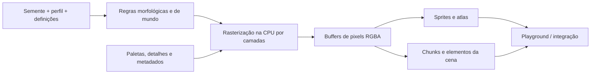

<div align="center">

# PPAE Engine

### Motor Procedural de Pixel Art

**Pixel art é mais poderoso quando é um sistema, não apenas uma coleção de sprites.**

Um conjunto modular de ferramentas de geração procedural e determinística para jogos 2D. Gere personagens, criaturas, cenários, animações e efeitos visuais em TypeScript, com resultados reproduzíveis e código aberto.

[](https://github.com/Mairon31/ppae-engine/tree/master)
[](package.json)
[](tsconfig.json)
[](https://github.com/Mairon31/ppae-engine/actions/workflows/ppae-2-ci.yml)
[](LICENSE)

**Idiomas:** [English](README.md) | [Español](README.es.md) | **Português (Brasil)**

**[Visitar a página](https://mairon31.github.io/ppae-engine/?lang=pt)** · **[Abrir o Playground](https://mairon31.github.io/ppae-engine/?lang=pt#world)** · **[Contribuir](https://github.com/Mairon31/ppae-engine/issues)**

</div>

---

## Aviso sobre desenvolvimento assistido por IA

> **Transparência:** O PPAE Engine é desenvolvido com auxílio de ferramentas de inteligência artificial em programação, testes, documentação e exploração técnica. A assistência de IA não garante código livre de erros nem pronto para produção. Os mantenedores decidem quais mudanças aceitar; os resultados devem ser revisados e validados.

## Pixel art gerado com propósito

**PPAE** é uma biblioteca de geração gráfica procedural de código aberto escrita em **TypeScript estrito**. Em vez de tratar cada frame, objeto ou variação como um asset independente, ela modela as regras por trás da aparência: anatomia, morfologia, paletas, direções, materiais, animações e sementes determinísticas.

O mesmo pipeline pode gerar árvores em diferentes estágios de vida, personagens animados em oito direções, praias com água em movimento ou atlas de criaturas com metadados estruturados.

O objetivo **não é substituir artistas**, mas oferecer a artistas, desenvolvedores e programadores criativos uma base programável para mundos 2D visualmente coerentes.

O PPAE começou como tecnologia para o [PixelProject](https://github.com/Mairon31/pixelproject), mas está evoluindo como um motor **independente e reutilizável**.

> **O que é:** uma biblioteca de geração procedural de pixel art com Playground visual e utilitários de integração.  
> **O que não é:** um motor completo de jogos com mecânicas, física, rede ou editor equivalente ao Godot ou Unity.

## Veja o motor em ação

**[Landing page em português](https://mairon31.github.io/ppae-engine/?lang=pt)** · **[Playground com 30 laboratórios](https://mairon31.github.io/ppae-engine/?lang=pt#world)**

O Playground oferece 30 laboratórios interativos conectados a **geradores reais** do motor, sem imagens promocionais pré-renderizadas. Inclui editor de personagens e equipamentos, variações de NPCs e criaturas, chefes, ciclos de vida, autotiling, materiais repetíveis, água, clima, partículas VFX e perfis de detalhe nativo.

É possível ajustar sementes, resolução, direção, animação, idade, saúde, cores, roupas, armaduras, hora do dia, clima e velocidade; além de exportar sprites PNG nativos, capturas, spritesheets e metadados JSON.
As capturas do Playground serão adicionadas ao README público quando estiverem disponíveis.

## O que o PPAE pode gerar?

| Sistema | Capacidades implementadas |
| :--- | :--- |
| **Personagens e NPCs** | Anatomia com 16 articulações, oito direções, aparência e equipamento configuráveis, oito arquétipos profissionais de NPCs e 28 ações de personagem. |
| **Criaturas e chefes** | 16 espécies, dez famílias anatômicas, 12 ações de criaturas, variações de idade/saúde e dois arquétipos de chefes multissegmentados. |
| **Árvores e vegetação** | 12 famílias botânicas com arquétipos estruturais e ciclos de vida, além de 17 tipos de flora secundária. |
| **Terreno e água** | Campos determinísticos, renderização de chunks, autotiling de 47 estados, caminhos, costas, transições, líquidos animados e materiais por bioma. |
| **Geologia e cenários** | 17 tipos de formações e recursos geológicos, estruturas, telhados, interiores, cavernas, plantações e objetos decorativos. |
| **Animação e exportação** | Compilação de spritesheets em oito direções, metadados por frame, âncoras, hitboxes, eventos de animação e atlas compactados. |
| **VFX e atmosfera** | Dezesseis emissores de partículas com quatro formatos de pixels, vento, relâmpagos ramificados, neblina em camadas, sombras solares direcionais e iluminação pela hora do dia. |
| **UI e equipamentos** | Ícones de equipamentos gerados proceduralmente, componentes de inventário/HUD e painéis nine-slice. |
| **Auditoria de qualidade artística** | Análise de silhuetas, paletas, luz e ruído, verificação de emendas e registro de dez referências com assinaturas RGBA. |
| **Cena e inspetor visual de produção** | Mundo por profundidade, clima, sombras solares, telhado removível, telemetria ao vivo e cinco resoluções; 32 laboratórios do Playground. |

Esses sistemas existem na ramificação de desenvolvimento atual. O refinamento artístico, o desempenho e a cobertura seguem em evolução durante a fase alfa.

## Feito para desenvolvedores e vibe coders

**Criadores independentes:** produza variações sem redesenhar cada asset; compartilhe definições e sementes para preservar a direção de arte.

**Desenvolvedores assistidos por IA:** use APIs tipadas e código inspecionável em vez de um serviço fechado de geração de imagens. Agentes de programação podem prototipar com geradores determinísticos mantendo as mudanças revisáveis.

**Artistas técnicos:** refine silhuetas, anatomia, composição em camadas, paletas e regras de animação; contribua com sistemas visuais reutilizáveis.

**Engenheiros experientes:** ajude a melhorar rasterização, cache, perfilamento, atlas, integrações e testes de regressão visual.

### Princípios técnicos

- **Reprodutibilidade:** as mesmas entradas e sementes seguem caminhos determinísticos; a paridade binária entre todos os ambientes ainda não foi certificada.
- **Geração independente:** produza buffers de pixels e metadados em TypeScript sem depender de uma API externa de geração de imagens.
- **Resolução nativa:** os perfis ajustam regras e orçamento de detalhes, não apenas ampliam bitmaps.
- **Arquitetura modular:** morfologia, paletas, rasterização, animação, geração de mundo e integração são sistemas separados.
- **Saídas inspecionáveis:** buffers RGBA, pivôs, âncoras e metadados estruturados.
- **Testes e desempenho:** há testes automatizados e benchmarks de geração na CPU; o desempenho em jogos reais exige medições separadas.

## Cinco resoluções visuais nativas

| Perfil | Tamanho do módulo | Uso previsto |
| :--- | :---: | :--- |
| `micro-4x4` | 4 × 4 | Assets compactos e prévias rápidas |
| `micro-6x6` | 6 × 6 | Sprites pequenos e expressivos |
| `classic-8x8` | 8 × 8 | Pixel art tradicional equilibrado |
| `standard-16x16` | 16 × 16 | Personagens e ambientes mais detalhados |
| `detailed-32x32` | 32 × 32 | Renderização procedural com maior detalhamento |

Perfis híbridos e adaptativos também estão disponíveis. O tamanho de módulo descreve a granularidade de geração, não um tamanho fixo universal de tela.

**A documentação pública para desenvolvedores estará disponível futuramente no GitHub Pages.** Até lá, use os exemplos deste README e o Playground interativo.

## Início rápido

**Requisitos:** Node.js `^20.19.0` ou `>=22.12.0` e npm.

Use a branch padrão **`master`** para a versão pública. Outras branches podem conter alterações experimentais ainda não integradas.

```bash
git clone --branch master https://github.com/Mairon31/ppae-engine.git
cd ppae-engine
npm ci
npm run dev
```

Abra a URL local do Vite exibida no terminal (normalmente `http://localhost:5173/`).

### Validar e compilar

```bash
npm run typecheck       # Verificação estrita de TypeScript
npm test                # Testes unitários e de regressão
npm run build           # Biblioteca ESM, tipos e demo
npm run check:package   # Inspecionar o pacote npm
npm run preview         # Prévia da compilação do GitHub Pages
```

A compilação produz `dist/library/` (módulo ESM), declarações em `dist/` e a web de demonstração em `dist/demo/`.

**Distribuição npm:** O pacote `@pixelproject/ppae` (`0.2.0-alpha.1`) ainda não foi publicado. Inclui o motor compilado, tipos TypeScript, README principal, licença e metadados; exclui o Playground, o site e os testes. Até sua publicação, compile e instale ou vincule o pacote localmente.

## Usando o motor com TypeScript

Os exemplos utilizam exports públicos do pacote após instalação ou vinculação local da biblioteca.

### Gerar uma árvore

```ts
import { DEFAULT_STYLE_PROFILES, NatureGenerator } from '@pixelproject/ppae';

const nature = new NatureGenerator();
const profile = DEFAULT_STYLE_PROFILES['classic-8x8'];
const oak = nature.generateTreeStage('oak', 'mature', profile, 2026, {
  envState: 'autumn',
  windShiftTexels: 2,
});

console.log(oak.buffer.data);  // Dados RGBA dos pixels
console.log(oak.pivotTexel);   // Pivô no chão
```

### Gerar um chunk determinístico

```ts
import {
  ChunkWorldRenderer, DEFAULT_STYLE_PROFILES, DeterministicWorldField
} from '@pixelproject/ppae';

const field = new DeterministicWorldField('my-world-seed');
const renderer = new ChunkWorldRenderer(field);
const chunk = renderer.renderChunk(0, 0, DEFAULT_STYLE_PROFILES['classic-8x8']);

console.log(chunk.terrainBuffer.width, chunk.terrainBuffer.height);
console.log(chunk.sortedProps);
```

### Compilar um atlas em oito direções

```ts
import {
  ALL_DIRECTIONS_8, DEFAULT_HERO_APPEARANCE, DEFAULT_HERO_EQUIPMENT,
  DEFAULT_STYLE_PROFILES, SpritesheetCompiler
} from '@pixelproject/ppae';

const compiler = new SpritesheetCompiler();
const sheet = compiler.compileCharacterSheet(
  DEFAULT_HERO_APPEARANCE,
  DEFAULT_HERO_EQUIPMENT,
  DEFAULT_STYLE_PROFILES['classic-8x8'],
  ['idle', 'walk', 'attack'],
  ALL_DIRECTIONS_8
);

console.log(sheet.atlasBuffer);     // Atlas de pixels RGBA
console.log(sheet.metadata.frames); // Frames, pivôs, eventos e hitboxes
```

O Playground também exporta atlas PNG e metadados JSON para seleções compatíveis.

## Como funciona



O código está dividido nos módulos `src/core`, `vegetation`, `terrain`, `entities`, `animation`, `structures`, `interiors`, `environment`, `lighting`, `vfx`, `items`, `ui`, `runtime`, `integration`, `benchmarks` e `demo`.

O `PhaserPPAEAdapter` registra texturas Canvas de assets gerados; ele não representa um framework completo de mecânicas de jogo.

## Status atual e roadmap

O PPAE está em **desenvolvimento alfa ativo**. As fases documentadas até **12** têm implementação e testes automatizados, incluindo dez construções, interiores de cabana, ferraria e alquimia e formações de cavernas; a validação artística de todas as sementes e resoluções ainda continua. O Playground e a biblioteca compilada estão disponíveis, e novas integrações, melhorias visuais e otimizações são oportunidades de contribuição.

**Acompanhe o desenvolvimento:** [Commits da master](https://github.com/Mairon31/ppae-engine/commits/master) · [Issues](https://github.com/Mairon31/ppae-engine/issues) · [Pull requests](https://github.com/Mairon31/ppae-engine/pulls).

## Como contribuir

**Estamos procurando colaboradores experientes.** As áreas prioritárias incluem silhuetas e anatomia, qualidade da vegetação, desempenho e memória, regressões visuais, integrações com frameworks de jogos e experiência dos desenvolvedores.

Você pode [consultar os issues](https://github.com/Mairon31/ppae-engine/issues), [propor uma melhoria](https://github.com/Mairon31/ppae-engine/issues/new) ou revisar o [pull requests abertos](https://github.com/Mairon31/ppae-engine/pulls). Para alterações grandes, abra um issue primeiro e inclua testes e capturas antes/depois quando necessário.

## Apoie o projeto

Se o PPAE pode ajudar seu próximo jogo, [marque o repositório com uma estrela](https://github.com/Mairon31/ppae-engine), experimente o [Playground](https://mairon31.github.io/ppae-engine/?lang=pt#world), compartilhe resultados ou contribua com código e feedback técnico.

## Licença

Distribuído sob a **[Licença Apache 2.0](LICENSE)**.

---

<div align="center">

**PPAE Engine — Gere as regras. Molde os pixels. Construa o mundo.**

[Playground](https://mairon31.github.io/ppae-engine/?lang=pt#world) · [Código](https://github.com/Mairon31/ppae-engine) · [Issues](https://github.com/Mairon31/ppae-engine/issues) · [Licença](LICENSE)

</div>
