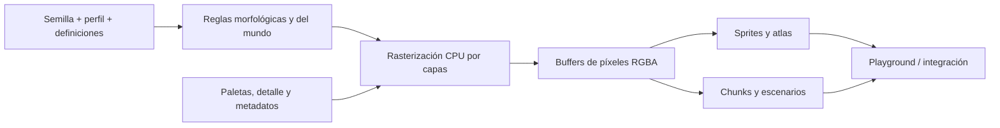

<div align="center">

# PPAE Engine

### Motor Procedural de Pixel Art

**El pixel art es más potente cuando es un sistema, no solo una colección de sprites.**

Herramientas modulares de generación procedural y determinista para videojuegos 2D. Genera personajes, criaturas, escenarios, animaciones y efectos visuales con TypeScript, resultados reproducibles y código abierto.

[](https://github.com/Mairon31/ppae-engine/pull/2)
[](../../package.json)
[](../../tsconfig.json)
[](https://github.com/Mairon31/ppae-engine/actions/workflows/ppae-2-ci.yml)
[](../../LICENSE)

**Idiomas:** [English](../../README.md) | **Español** | [Português (Brasil)](README.pt-BR.md)

**[Visitar la web](https://mairon31.github.io/ppae-engine/?lang=es)** · **[Abrir el Playground](https://mairon31.github.io/ppae-engine/?lang=es#world)** · **[Contribuir](https://github.com/Mairon31/ppae-engine/issues)**

</div>

---

## Pixel art generado con propósito

**PPAE** es una biblioteca abierta de generación gráfica procedural escrita en **TypeScript estricto**. En lugar de tratar cada frame, objeto o variante como un asset aislado, modela las reglas detrás de su apariencia: anatomía, morfología, paletas, direcciones, materiales, animaciones y semillas.

El mismo pipeline puede generar un árbol con distintas etapas de vida, personajes animados en ocho direcciones, costas con agua en movimiento o un atlas de criaturas acompañado de metadatos.

El objetivo **no es sustituir a los artistas**, sino darles a ellos, a los desarrolladores y a los programadores creativos una base programable para crear mundos 2D visualmente coherentes.

PPAE nació como tecnología para [PixelProject](https://github.com/Mairon31/pixelproject), pero se desarrolla como motor **independiente y reutilizable**.

> **Qué es:** una biblioteca de generación procedural de pixel art, con Playground visual y herramientas de integración.  
> **Qué no es:** un motor completo de juego con mecánicas, físicas, redes o un editor equivalente a Godot o Unity.

## Explora el motor

**[Landing page en español](https://mairon31.github.io/ppae-engine/?lang=es)** · **[Playground de 30 laboratorios](https://mairon31.github.io/ppae-engine/?lang=es#world)**

El Playground ofrece 30 laboratorios interactivos que consumen **generadores reales** del motor, sin imágenes de demostración prefabricadas. Incluye un editor de personaje y equipo, variaciones de NPC y criaturas, jefes, ciclos de vida, autotiling, materiales repetibles, agua, clima, partículas VFX y distintos perfiles de detalle nativo.

Puedes ajustar semillas, resolución, dirección, animación, edad, salud, colores, ropa, armaduras, hora, clima y velocidad; y exportar sprites PNG nativos, capturas, spritesheets y metadatos JSON.

Las capturas del Playground se añadirán manualmente al README principal. La [matriz de cobertura](../PLAYGROUND_COVERAGE_MATRIX.md) distingue las funciones realmente expuestas de las API internas que todavía no cuentan con una demostración interactiva.

## Qué puede generar PPAE

| Sistema | Capacidades implementadas |
| :--- | :--- |
| **Personajes y NPC** | Anatomía con 16 articulaciones, ocho direcciones, aspectos y equipos personalizables, ocho profesiones de NPC y 28 acciones de personaje. |
| **Criaturas y jefes** | 16 especies, diez familias anatómicas, 12 acciones de criatura, edad y salud variables, y dos arquetipos de jefes multisegmento. |
| **Árboles y vegetación** | 12 familias botánicas con arquetipos estructurales y etapas de vida; 17 tipos de flora secundaria. |
| **Terreno y agua** | Campos deterministas, chunks, autotiling de 47 estados, caminos, costas, transiciones, líquidos animados y materiales por bioma. |
| **Geología y escenarios** | 17 tipos de recursos geológicos, estructuras, tejados, interiores, cuevas, cultivos y elementos decorativos. |
| **Animación y exportación** | Spritesheets en ocho direcciones, metadatos por fotograma, anclas, hitboxes, eventos y atlas empaquetados. |
| **VFX y atmósfera** | Dieciséis emisores de partículas con cuatro formas de píxeles, viento, relámpagos ramificados, niebla por capas, sombras solares direccionales e iluminación por hora. |
| **UI y equipo** | Iconos procedurales de equipamiento, componentes de inventario/HUD y paneles nine-slice. |

Estas capacidades existen en la rama de desarrollo actual. La calidad artística, el rendimiento y la cobertura de casos continúan evolucionando durante la etapa alfa.

## Diseñado para desarrolladores y vibe coders

**Creadores independientes:** crea variaciones sin redibujar cada asset; comparte definiciones y semillas para mantener la dirección artística.

**Desarrolladores asistidos por IA:** trabaja con API tipadas y código inspeccionable en vez de depender de un servicio opaco de generación de imágenes. Los agentes de programación pueden prototipar con generadores deterministas y cambios revisables.

**Artistas técnicos:** mejora siluetas, anatomía, capas, paletas y reglas de animación; contribuye sistemas visuales reutilizables.

**Ingenieros experimentados:** ayuda a perfeccionar rasterización, caché, análisis de rendimiento, atlas, integraciones y regresión visual.

### Principios técnicos

- **Reproducibilidad:** la misma entrada y semilla siguen rutas deterministas; la paridad binaria entre todos los entornos todavía no está certificada.
- **Generación independiente:** produce buffers de píxeles y metadatos en TypeScript sin depender de una API generativa externa.
- **Resolución nativa:** cada perfil ajusta reglas y presupuesto de detalle, no solo amplía un bitmap.
- **Arquitectura modular:** morfología, paletas, rasterización, animación, generación de mundo e integración están separados.
- **Salidas inspeccionables:** buffers RGBA, pivotes, anclas y metadatos estructurados.
- **Pruebas y rendimiento:** el repositorio incluye pruebas automatizadas y benchmarks de generación CPU; el rendimiento de un juego real requiere mediciones aparte.

## Cinco resoluciones visuales nativas

| Perfil | Tamaño de módulo | Aplicación |
| :--- | :---: | :--- |
| `micro-4x4` | 4 × 4 | Assets compactos y vistas rápidas |
| `micro-6x6` | 6 × 6 | Sprites pequeños y expresivos |
| `classic-8x8` | 8 × 8 | Pixel art clásico equilibrado |
| `standard-16x16` | 16 × 16 | Personajes y entornos detallados |
| `detailed-32x32` | 32 × 32 | Renderizado procedural de mayor detalle |

También existen perfiles híbridos y adaptativos. El tamaño de módulo describe la granularidad de generación, no un lienzo de dimensiones universales.

## Comienzo rápido

**Requisitos:** Node.js `^20.19.0` o `>=22.12.0`, y npm.

La versión 2.0 se desarrolla en `feat/ppae-2-art-overhaul` y el [Pull Request #2](https://github.com/Mairon31/ppae-engine/pull/2).

```bash
git clone --branch feat/ppae-2-art-overhaul https://github.com/Mairon31/ppae-engine.git
cd ppae-engine
npm ci
npm run dev
```

Abre la URL local de Vite que aparece en la terminal (normalmente `http://localhost:5173/`).

### Pruebas y compilación

```bash
npm run typecheck       # Revisión estricta de TypeScript
npm test                # Pruebas unitarias y regresiones
npm run build           # Biblioteca ESM, tipos y demo
npm run check:package   # Auditar los archivos del paquete npm
npm run preview         # Ver la compilación de GitHub Pages
```

El build genera `dist/library/` (módulo ESM), declaraciones en `dist/` y la web de demostración en `dist/demo/`.

**Distribución npm:** `package.json` define `@pixelproject/ppae` en versión `0.2.0-alpha.1`. Esto no implica que ya esté publicado. El paquete solo debe incluir el motor compilado, los tipos públicos, README principal, licencia y metadatos; **la landing, los idiomas adicionales, el Playground, las pruebas y la documentación interna se quedan en GitHub**. Véase [distribución npm](../NPM_DISTRIBUTION.md).

## Uso desde TypeScript

Los ejemplos utilizan las exportaciones públicas del motor, una vez instalada o enlazada localmente la biblioteca.

### Generar un árbol

```ts
import { DEFAULT_STYLE_PROFILES, NatureGenerator } from '@pixelproject/ppae';

const nature = new NatureGenerator();
const profile = DEFAULT_STYLE_PROFILES['classic-8x8'];
const oak = nature.generateTreeStage('oak', 'mature', profile, 2026, {
  envState: 'autumn',
  windShiftTexels: 2,
});

console.log(oak.buffer.data);  // Píxeles RGBA
console.log(oak.pivotTexel);   // Punto de apoyo en el suelo
```

### Generar un chunk determinista

```ts
import {
  ChunkWorldRenderer, DEFAULT_STYLE_PROFILES, DeterministicWorldField
} from '@pixelproject/ppae';

const field = new DeterministicWorldField('my-world-seed');
const renderer = new ChunkWorldRenderer(field);
const chunk = renderer.renderChunk(0, 0, DEFAULT_STYLE_PROFILES['classic-8x8']);

console.log(chunk.terrainBuffer.width, chunk.terrainBuffer.height);
console.log(chunk.sortedProps);
```

### Compilar un atlas de ocho direcciones

```ts
import {
  ALL_DIRECTIONS_8, DEFAULT_HERO_APPEARANCE, DEFAULT_HERO_EQUIPMENT,
  DEFAULT_STYLE_PROFILES, SpritesheetCompiler
} from '@pixelproject/ppae';

const compiler = new SpritesheetCompiler();
const sheet = compiler.compileCharacterSheet(
  DEFAULT_HERO_APPEARANCE,
  DEFAULT_HERO_EQUIPMENT,
  DEFAULT_STYLE_PROFILES['classic-8x8'],
  ['idle', 'walk', 'attack'],
  ALL_DIRECTIONS_8
);

console.log(sheet.atlasBuffer);      // Atlas de píxeles RGBA
console.log(sheet.metadata.frames); // Frames, pivotes, eventos y hitboxes
```

El Playground permite exportar atlas PNG y metadatos JSON para selecciones compatibles.

## Cómo funciona



La implementación está organizada en módulos `src/core`, `vegetation`, `terrain`, `entities`, `animation`, `structures`, `interiors`, `environment`, `lighting`, `vfx`, `items`, `ui`, `runtime`, `integration`, `benchmarks` y `demo`.

El adaptador `PhaserPPAEAdapter` registra texturas Canvas a partir de assets generados; no es un framework de mecánicas ni una integración de juego completa.

## Estado y hoja de ruta

PPAE está en **desarrollo alfa activo**. Las fases documentadas hasta **10** están implementadas con pruebas, incluyendo diez estructuras, interiores de cabaña, herrería y alquimia y formaciones de cuevas, pero la validación visual de todas las semillas y perfiles continúa. El Playground funciona, las exportaciones y declaraciones están compiladas y existen oportunidades para mejorar integración, rendimiento y calidad artística.

**Seguir el desarrollo:** [Progreso de implementación](../PPAE_2_0_IMPLEMENTATION_PROGRESS.md) · [Arquitectura del Playground](../PLAYGROUND.md) · [PR #2](https://github.com/Mairon31/ppae-engine/pull/2).

## Contribuciones

**Buscamos colaboradores técnicos.** Las áreas prioritarias son mejorar siluetas, vegetación y anatomía; optimizar caché y memoria; desarrollar regresiones visuales; ampliar integraciones con motores de juegos y mejorar las herramientas de desarrollo.

Puedes [ver los issues](https://github.com/Mairon31/ppae-engine/issues), [proponer una mejora](https://github.com/Mairon31/ppae-engine/issues/new) o revisar el [PR activo](https://github.com/Mairon31/ppae-engine/pull/2). Para cambios grandes, abre primero un issue y añade pruebas y capturas antes/después cuando sea posible.

## Apoya el proyecto

Si PPAE puede ayudarte, [marca el repositorio con una estrella](https://github.com/Mairon31/ppae-engine), prueba el [Playground](https://mairon31.github.io/ppae-engine/?lang=es#world), comparte tus resultados o contribuye código y comentarios técnicos.

## Licencia

Publicado bajo la **[Licencia Apache 2.0](../../LICENSE)**.

---

<div align="center">

**PPAE Engine — Genera reglas. Da forma a los píxeles. Construye el mundo.**

[Playground](https://mairon31.github.io/ppae-engine/?lang=es#world) · [Código](https://github.com/Mairon31/ppae-engine) · [Issues](https://github.com/Mairon31/ppae-engine/issues) · [Licencia](../../LICENSE)

</div>
